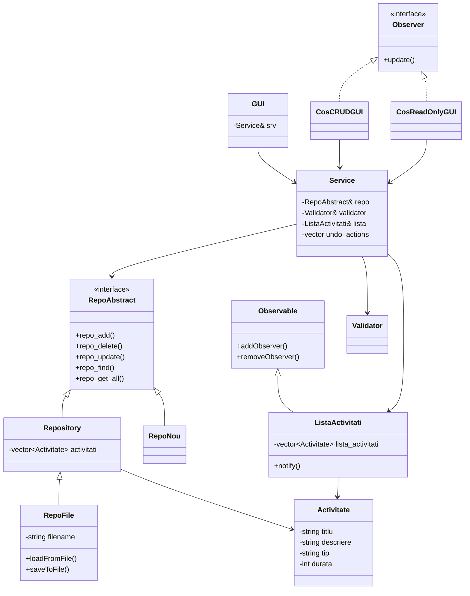
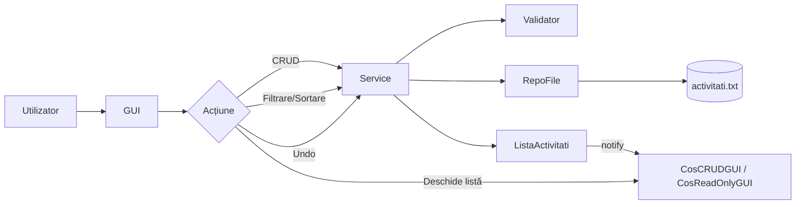

# Documentație arhitecturală — Management Activități

**Proiect:** lab13-14_2  
**Limbaj:** C++20  
**Framework UI:** Qt 6 (Widgets)  
**Build system:** CMake  
**Scop:** Aplicație desktop pentru gestionarea unei colecții de activități, cu persistență pe fișier, operații avansate (filtrare, sortare, undo) și o listă secundară de activități selectate.

---

## 1. Ideea generală a proiectului

Aplicația **Management Activități** este un sistem de tip CRUD (Create, Read, Update, Delete) care permite utilizatorului să administreze o colecție de **activități**. Fiecare activitate este descrisă prin patru atribute:

| Atribut     | Tip      | Descriere                                      |
|-------------|----------|------------------------------------------------|
| `titlu`     | string   | Numele activității                             |
| `descriere` | string   | Detalii despre activitate                      |
| `tip`       | string   | Categoria activității (ex: sport, muncă, hobby)|
| `durata`    | int      | Durata în minute (strict pozitivă)             |

**Cheia unică** a unei activități este perechea `(titlu, tip)` — două activități cu același titlu și tip sunt considerate identice.

### Ce poate face utilizatorul?

1. **Gestionare activități principale**
   - Adăugare, ștergere, modificare
   - Căutare după titlu + tip
   - Filtrare după descriere sau tip
   - Sortare după titlu, descriere, sau tip + durată
   - Undo pentru ultimele operații de modificare a repository-ului

2. **Listă secundară de activități** (concept de „coș” / selecție)
   - Adăugare manuală (după titlu) sau generare aleatoare
   - Golire listă
   - Export în CSV sau HTML
   - Vizualizare read-only sub formă de imagini desenate pe ecran (Observer pattern)

3. **Raportare**
   - Număr de activități grupate pe tip

4. **Persistență**
   - Datele sunt salvate automat în fișierul `activitati.txt` (format CSV pe linie)

### Context academic (Laborator OOP 13–14)

Proiectul demonstrează concepte de programare orientată pe obiecte:

- **Separarea responsabilităților** pe straturi (Domain → Repository → Service → UI)
- **Polimorfism** prin interfața `RepoAbstract` și implementările `Repository`, `RepoFile`, `RepoNou`
- **Observer pattern** pentru sincronizarea UI-ului cu lista secundară
- **Command pattern** pentru mecanismul de Undo
- **Model-View** cu `TableModel` (Qt) pentru afișarea tabulară
- **Validare** separată de logică de business
- **Gestionarea excepțiilor** pe straturi (`ValidationException`, `RepoException`, `ServiceException`, `ListException`)

---

## 2. Arhitectura de ansamblu

Aplicația urmează o **arhitectură în straturi (Layered Architecture)** cu dependențe unidirectionale: UI → Service → Repository → Domain.

```
┌─────────────────────────────────────────────────────────────────┐
│                     PREZENTARE (Presentation)                   │
│  ┌──────────────┐  ┌──────────────┐  ┌───────────────────────┐  │
│  │     GUI      │  │ CosCRUDGUI   │  │   CosReadOnlyGUI      │  │
│  │  (Qt Widgets)│  │  (Observer)  │  │     (Observer)        │  │
│  └──────┬───────┘  └──────┬───────┘  └───────────┬───────────┘  │
│         │                 │                      │              │
│  ┌──────┴─────────────────┴──────────────────────┴───────────┐  │
│  │                    Console (ui.cpp)                         │  │
│  └──────────────────────────┬──────────────────────────────────┘  │
└─────────────────────────────┼─────────────────────────────────────┘
                              │
┌─────────────────────────────┼─────────────────────────────────────┐
│                   BUSINESS LOGIC (Service)                        │
│  ┌──────────────────────────┴──────────────────────────────────┐  │
│  │                         Service                              │  │
│  │  • CRUD delegat + validare                                   │  │
│  │  • Filtrare / Sortare                                        │  │
│  │  • Undo (Command pattern)                                    │  │
│  │  • Operații pe ListaActivitati                               │  │
│  │  • Raport (RaportDTO)                                        │  │
│  └───────┬──────────────────┬──────────────────┬────────────────┘  │
│          │                  │                  │                   │
│  ┌───────┴───────┐  ┌───────┴────────┐  ┌─────┴─────────────────┐  │
│  │   Validator   │  │ ListaActivitati│  │  undo_actions (stack)│  │
│  │               │  │  (Observable)  │  │  UndoAdauga/Sterge/  │  │
│  │               │  │                │  │  Modifica            │  │
│  └───────────────┘  └────────────────┘  └──────────────────────┘  │
└─────────────────────────────┬─────────────────────────────────────┘
                              │
┌─────────────────────────────┼─────────────────────────────────────┐
│                    PERSISTENȚĂ (Repository)                       │
│  ┌──────────────────────────┴──────────────────────────────────┐  │
│  │                    RepoAbstract (interfață)                   │  │
│  └────────────┬────────────────────┬───────────────────────────┘  │
│               │                    │                              │
│  ┌────────────┴────────┐  ┌───────┴────────┐  ┌───────────────┐  │
│  │    Repository       │  │    RepoFile     │  │    RepoNou    │  │
│  │  (in-memory vector) │  │  (+ file I/O)   │  │  (map + rand) │  │
│  └─────────────────────┘  └─────────────────┘  └───────────────┘  │
└─────────────────────────────┬─────────────────────────────────────┘
                              │
┌─────────────────────────────┼─────────────────────────────────────┐
│                       DOMENIU (Domain)                            │
│  ┌──────────────────────────┴──────────────────────────────────┐  │
│  │                        Activitate                            │  │
│  └─────────────────────────────────────────────────────────────┘  │
└───────────────────────────────────────────────────────────────────┘
```

---

## 3. Componente și responsabilități

### 3.1 Stratul de domeniu

#### `Activitate`
Entitatea centrală a aplicației.

- **Responsabilitate:** Reprezintă o activitate cu getteri/setteri și egalitate definită pe `(titlu, tip)`.
- **Fișiere:** `activitate.h`, `activitate.cpp`

---

### 3.2 Stratul de persistență

#### `RepoAbstract`
Interfață abstractă (clasa de bază pur virtuală) pentru accesul la date.

| Metodă            | Descriere                              |
|-------------------|----------------------------------------|
| `repo_add`        | Adaugă o activitate                    |
| `repo_delete`     | Șterge după titlu + tip                |
| `repo_update`     | Actualizează o activitate existentă    |
| `repo_find`       | Caută o activitate                     |
| `repo_get_all`    | Returnează toate activitățile          |

#### `Repository`
Implementare în memorie cu `std::vector<Activitate>`.

- Verifică duplicate la adăugare
- Aruncă `RepoException` la erori

#### `RepoFile` *(folosit în producție)*
Extinde `Repository` cu persistență pe disc.

- **Fișier:** `activitati.txt`
- **Format:** `titlu,descriere,tip,durata` (câte o activitate pe linie)
- **Comportament:** La fiecare add/delete/update se rescrie fișierul (`saveToFile`)
- **La pornire:** Încarcă datele existente (`loadFromFile`)

#### `RepoNou` *(pentru testare)*
Implementare alternativă cu `std::map` care simulează eșecuri aleatorii (`throw_random`) — utilă pentru testarea robusteții service-ului.

- **Fișiere:** `repository.h`, `repository.cpp`

---

### 3.3 Stratul de business logic

#### `Validator`
Validează o activitate înainte de add/update:

- Titlu, descriere, tip — nevide
- Durata — strict pozitivă
- Aruncă `ValidationException` cu mesaj concatenat

#### `Service`
Orchestratorul principal al aplicației. Primește prin constructor referințe la:
- `RepoAbstract& repo`
- `Validator& validator`
- `ListaActivitati& lista`

**Operații principale:**

| Grup              | Metode                                              |
|-------------------|-----------------------------------------------------|
| CRUD              | `srv_add`, `srv_delete`, `srv_update`, `srv_search`, `srv_get_all` |
| Filtrare          | `srv_filtrare_desc`, `srv_filtrare_tip`             |
| Sortare           | `srv_sort_titlu`, `srv_sort_desc`, `srv_sort_tip_durata` |
| Undo              | `srv_undo`                                          |
| Listă secundară   | `srv_add_to_list`, `srv_clear_list`, `srv_generate_list`, `srv_export_list`, `srv_get_list_size` |
| Raport            | `srv_creare_raport`                                 |

**Undo:** La fiecare add/delete/update, se creează un obiect `ActiuneUndo` (polimorf) și se adaugă pe un stack (`std::vector<std::unique_ptr<ActiuneUndo>>`). `srv_undo()` execută ultima acțiune inversă.

#### `ListaActivitati` *(Observable)*
Listă secundară de activități selectate din repository.

- Notifică observerii la `add_to_list` și `clear_list`
- Export CSV/HTML
- **Fișiere:** `lista_activitati.h`, `lista_activitati.cpp`

#### `RaportDTO`
Agregă activitățile pe tip într-un `std::map<std::string, int>`.

- **Fișiere:** `raport.h`, `raport.cpp`

---

### 3.4 Stratul de prezentare

#### `GUI` — fereastra principală
Interfață Qt cu:

- **ListWidget** + **QTableView** (via `TableModel`) — afișare duală
- Formular CRUD (titlu, descriere, tip, durată)
- Butoane filtrare și sortare
- Buton Undo
- Deschidere ferestre secundare: `CosCRUDGUI`, `CosReadOnlyGUI`

#### `CosCRUDGUI` — gestionare listă secundară
Implementează `Observer`; se actualizează automat când `ListaActivitati` se modifică.

- Adăugare în listă după titlu
- Generare listă aleatoare (shuffle + primele N)
- Export CSV/HTML
- Golire listă

#### `CosReadOnlyGUI` — vizualizare read-only
Implementează `Observer`; redesenează fereastra la modificarea listei.

- Desenează imagini (`img1.png` … `img6.png`) în număr egal cu dimensiunea listei
- Poziții și scale aleatoare (vizualizare decorativă)

#### `TableModel`
Model Qt (`QAbstractTableModel`) pentru afișarea activităților în tabel — 4 coloane: Titlu, Descriere, Tip, Durata.

#### `Console`
Interfață text alternativă (meniu CLI) — aceleași operații ca GUI, accesibile prin `ui.cpp`. Nu este folosită în `main.cpp` curent (entry point-ul lansează GUI).

- **Fișiere:** `gui.h`, `gui.cpp`, `model_tabel.h`, `ui.h`, `ui.cpp`

---

### 3.5 Pattern-uri de design

#### Observer (`observer.h`)

```
Observable (ListaActivitati)
    │
    ├── addObserver(Observer*)
    ├── removeObserver(Observer*)
    └── notify() ──► Observer::update()
                          │
              ┌───────────┴───────────┐
              CosCRUDGUI          CosReadOnlyGUI
```

Permite decuplarea listei secundare de ferestrele care o afișează.

#### Command / Undo (`undo.h`)

```
ActiuneUndo (abstract)
    ├── UndoAdauga   → repo_delete(...)
    ├── UndoSterge   → repo_add(...)
    └── UndoModifica → repo_update(activitate_veche)
```

Service menține un stack de comenzi reversibile.

---

## 4. Flux de date

### 4.1 Pornirea aplicației (`main.cpp`)

```
Validator val
RepoFile repo("activitati.txt")   ← încarcă activități din fișier
ListaActivitati lista
Service srv(repo, val, lista)
GUI gui(srv)
gui.show()
app.exec()
```

### 4.2 Adăugare activitate

```
GUI (btnAdd)
  → Service::srv_add(titlu, desc, tip, durata)
      → Validator::validate(a)
      → RepoFile::repo_add(a)
          → Repository::repo_add(a)
          → RepoFile::saveToFile()
      → push UndoAdauga pe stack
  → GUI::reloadFereastra(srv_get_all())
```

### 4.3 Modificare listă secundară (cu notificare Observer)

```
CosCRUDGUI (btnAddLista)
  → Service::srv_add_to_list(titlu)
      → ListaActivitati::add_to_list(a)
          → notify()
              → CosCRUDGUI::update()
              → CosReadOnlyGUI::update() / repaint()
```

### 4.4 Undo

```
GUI (btnUndo)
  → Service::srv_undo()
      → undo_actions.back()->doUndo()
      → pop_back()
  → reloadFereastra
```

---

## 5. Gestionarea erorilor

| Excepție              | Strat       | Cauze tipice                              |
|-----------------------|-------------|-------------------------------------------|
| `ValidationException` | Validator   | Câmpuri goale, durată ≤ 0                 |
| `RepoException`       | Repository  | Duplicat, activitate inexistentă, I/O     |
| `ServiceException`    | Service     | Listă goală la undo, număr invalid, export|
| `ListException`       | Lista       | Eroare deschidere fișier la export        |

GUI prinde excepțiile și le afișează în `QMessageBox`.

---

## 6. Structura fișierelor

```
lab13-14 2/
├── main.cpp              # Entry point — inițializare + GUI
├── CMakeLists.txt        # Build Qt6
│
├── activitate.h/cpp      # Domain entity
├── validator.h/cpp       # Validare input
├── repository.h/cpp      # Persistență (abstract + implementări)
├── service.h/cpp         # Business logic
├── lista_activitati.h/cpp# Listă secundară (Observable)
├── raport.h/cpp          # DTO raport
├── undo.h                # Command pattern pentru undo
├── observer.h            # Observer pattern
│
├── gui.h/cpp             # Interfață grafică Qt
├── model_tabel.h         # TableModel pentru QTableView
├── ui.h/cpp              # Interfață consolă (alternativă)
│
├── vector_dinamic.h      # Container custom (lab anterior)
├── tests.h/cpp           # Teste unitare (comentate)
│
├── activitati.txt        # Persistență (generat la runtime)
└── ARCHITECTURE.md       # Acest document
```

---

## 7. Dependențe tehnice

| Dependență    | Rol                                      |
|---------------|------------------------------------------|
| C++20         | Standard language (`ends_with`, etc.)    |
| Qt 6 Core     | Event loop, tipuri de bază               |
| Qt 6 Gui      | QPainter, QImage                         |
| Qt 6 Widgets  | GUI components                           |
| STL           | vector, map, algorithm, fstream, memory  |
| CMake 4.1+    | Build și linking Qt                      |

---

## 8. Diagrame UML (conceptual)

### Relații între clase principale



### Flux utilizator — fereastra principală



---

## 9. Extensibilitate

Arhitectura permite extinderi fără modificarea straturilor superioare:

| Extensie                    | Cum se realizează                                      |
|-----------------------------|--------------------------------------------------------|
| Alt storage (DB, JSON)      | Nouă clasă derivată din `RepoAbstract`                 |
| Reguli de validare noi      | Extindere `Validator`                                  |
| UI web / mobil              | Nou strat Presentation care apelează același `Service` |
| Undo pentru listă secundară | Noi clase `ActiuneUndo` + logică în Service            |
| Rapoarte complexe           | Extindere `RaportDTO` sau noi DTO-uri                  |

---

## 10. Limitări cunoscute

1. **RepoFile rescrie întreg fișierul** la fiecare modificare — ineficient pentru volume mari de date.
2. **Undo acoperă doar operațiile pe repository**, nu și modificările listei secundare.
3. **Identificare activitate** doar prin `(titlu, tip)` — titlul nu poate fi duplicat între tipuri diferite fără conflict la add-to-list (care caută doar după titlu).
4. **Console UI** există dar nu este conectată în `main.cpp`.
5. **Testele** din `tests.cpp` sunt comentate — nu rulează automat la build.
6. **CosReadOnlyGUI** depinde de fișiere imagine (`img1.png` … `img6.png`) care trebuie să existe lângă executabil.

---

## 11. Rezumat

| Aspect              | Decizie arhitecturală                                      |
|---------------------|------------------------------------------------------------|
| Stil arhitectural   | Layered (4 straturi)                                       |
| Persistență         | Repository Pattern + File I/O                              |
| Validare            | Separată în `Validator`                                    |
| UI                  | Qt6 Widgets + Model-View (`TableModel`)                    |
| Sincronizare UI     | Observer pe `ListaActivitati`                              |
| Anulare operații    | Command Pattern (stack Undo)                               |
| Coupling            | Service depinde de abstracții (`RepoAbstract&`), nu de implementări concrete |

Proiectul modelează un **mini-ERP personal pentru activități**: stochează date persistent, aplică reguli de business, oferă interfață grafică bogată și demonstrează pattern-uri OOP clasice într-un context practic, potrivit laboratorului de Programare Orientată pe Obiecte.
